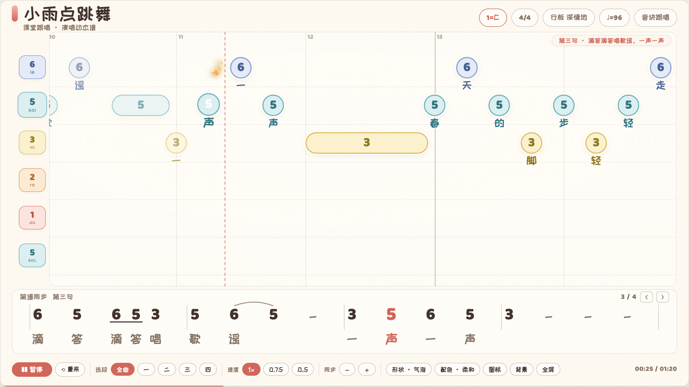
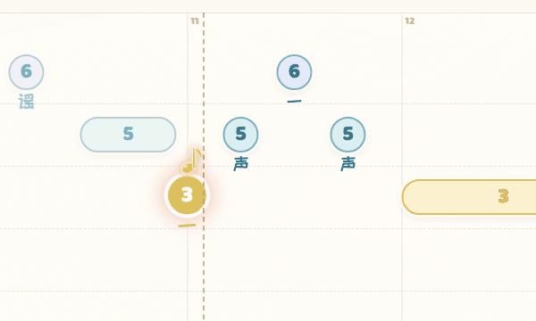

# scorecraft · 音块动态谱工坊

把「教材谱例 + 范唱录音」做成一份**可投屏、音画同步的课堂动态谱**，最后压成**一个可以离线双击打开的 HTML**。

给音乐老师用：谱面随范唱滚动，一个金色音符踩着拍点从一个音块跳到下一个音块，块下逐字歌词，底部简谱同步标红。

    [](https://github.com/Cristiamo-7/scorecraft/actions/workflows/validate.yml)



## 它长什么样

- **左侧音级轴**：do/re/mi 圆角卡片，当前音放大发光
- **彩色音块**：短音正圆、长音胶囊，三套形状（bubble / solid / jelly）× 四套低饱和配色
- **跳动音符**：随旋律上行跳跃、下行滑落，起跳拉长、落地压扁回弹，原地留残影
- **逐字歌词**：贴在各自音块正下方，唱到哪个字哪个字放大变色
- **简谱同步面板**：小节线、成组减时线、高低音点、一字多音连音弧，当前音实时标红
- **课堂功能**：前奏倒计时、选段循环、慢练倍速、同步微调、翻句



## 安装

把整个目录放到用户级技能目录：

```bash
git clone https://github.com/Cristiamo-7/scorecraft.git ~/.workbuddy/skills/scorecraft
```

或直接复制目录到 `~/.workbuddy/skills/scorecraft`。之后在对话里说「做一份动态谱」即可触发。

已安装过的话，更新用：

```bash
cd ~/.workbuddy/skills/scorecraft && git pull
```

## 快速开始

```bash
# 1. 开工作目录（模板、脚本、字体、谱例骨架一次放好）
python3 ~/.workbuddy/skills/scorecraft/scripts/new_project.py ~/Downloads/小星星动态谱 --title "小星星"

cd ~/Downloads/小星星动态谱

# 2. 逐音录谱：编辑 score.json（字段见 references/schema.md）

# 3. 对拍：自动测速度与起唱位置
cp 范唱.mp3 ./范唱.mp3
python3 align.py            # 先看报告
python3 align.py --write    # 认可后写回 tempo / audioOffset

# 4. 切字体子集 + 打包单文件
python3 make_font.py
python3 build.py            # 出 index.html，内置底图与音频（约 4MB）

# 5. 版面体检
python3 ~/.workbuddy/skills/scorecraft/scripts/check_layout.py index.html
```

课上只需要拷 `index.html` 一个文件。

## 目录结构

```
scorecraft/
├── SKILL.md                     # 技能说明：工作流、10 条硬规矩、验收判读、故障表
├── LICENSE                      # MIT（字体除外，见文末）
├── docs/                        # README 用的预览图与跳跃动图
├── .github/workflows/validate.yml  # CI：自检 + 打包示例 + 版面体检
├── scripts/
│   ├── new_project.py           # 开工作目录
│   ├── align.py                 # 音频对拍（chroma + 音高一致率）
│   ├── make_font.py             # 按用字切字体子集并 base64 内嵌
│   ├── build.py                 # 打包单文件 HTML（默认内嵌底图+音频，--link 出外链版）
│   ├── check_layout.py          # 无头浏览器版面体检，退出码 0/1
│   ├── check_skill.py           # 技能自检：文件齐全/占位符/示例谱例/脚本可编译
│   └── make_silence.py          # 造静音音轨，没有范唱时也能预览/体检
├── assets/
│   ├── template/score.template.html   # 页面模板：唯一样式与引擎来源
│   ├── fonts/                   # 站酷快乐体 + Baloo 2 + OFL 授权
│   └── example/score.json       # 自编示例谱例（51 音 / 4 句）
└── references/
    ├── schema.md                # score.json 字段速查
    ├── design-spec.md           # 尺寸常量、动画物理参数、改尺寸的三处联动
    └── user-guide-example.md    # 交付给老师的说明文样例
```

## 两个自检脚本

**技能自检**（改完 skill 本体先跑这个）：

```bash
python3 scripts/check_skill.py
```

查文件是否齐全（模板 / 字体 / OFL / 示例谱例 / 文档）、`SKILL.md` frontmatter 是否完整、模板四个占位符有没有丢、模板里有没有残留硬编码曲名、示例谱例字段是否合法且无重叠、脚本能否编译、文本是否 UTF-8。退出码 0/1。

**版面体检**（每次生成谱面都要跑）：

```bash
python3 scripts/check_layout.py index.html
```

注入 rAF 兼容层与可控时钟，用无头 Chrome 跑完全曲，报告：

- 歌词压音块 / 歌词互相压 / 歌词出界
- 简谱逐句越界、歌词压字
- 精灵冲出谱面上沿、NaN、JS 报错

全绿才交付。故意把字号撑爆时它会准确报出越界位置，退出码 1。

## 持续集成

`.github/workflows/validate.yml` 在每次 push / PR 时跑一遍完整链路：`check_skill.py` → 用示例谱例 `new_project.py` 搭目录 → `make_font.py` → `build.py` → `check_layout.py`，并把生成的 `index.html` 作为 artifact 留档（可以下载下来直接看效果）。CI 里用 `make_silence.py` 造一段 90 秒静音音轨（纯标准库，不依赖 ffmpeg）——没有可解码的音频时页面会退回虚拟时钟，注入的时间就不生效，体检会变成假绿。

## 硬规矩（摘）

1. 音频 `currentTime` 是唯一时钟，动画只读它
2. 不手改 `index.html`，改模板或 `score.json` 后重新 `build.py`
3. 休止 = **停住**，不是掉下去
4. 同一音级行的歌词共用一条基线
5. 简谱只用 `--dig-h` 一个变量联动
6. 尺寸按「后排看得清」定，动完必须重跑体检
7. 交付必须单文件离线（字体、底图、音频全部内嵌）

## 许可证

- **代码与文档**：MIT，见 `LICENSE`。可商用、可改造、可再分发，保留版权声明即可。
- **字体**：`assets/fonts/` 内站酷快乐体与 Baloo 2 遵循 **SIL Open Font License 1.1**，见 `assets/fonts/OFL.txt`。用它们生成的页面内嵌了字体子集，同样受 OFL 约束（可自由使用、修改、分发，但字体本身不得单独售卖）。
- **示例内容**：`assets/example/score.json`（《小雨点跳舞》）与 `references/user-guide-example.md` 是为演示格式**自编的示例**，词曲与文档均可自由改写、分发。

> 用它做教材歌曲时，词曲著作权仍归原作者——做好的动态谱自己上课用没问题，公开分发请先确认授权。
